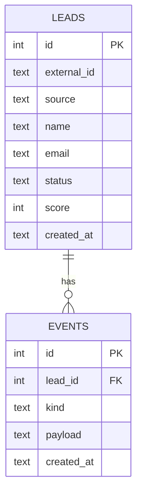

# lead-router

Small FastAPI service for lead intake. Idempotent writes, CSV import, YAML routing rules, SQLite, tests.


```bash
curl -X POST localhost:8000/leads \
  -H "Content-Type: application/json" \
  -d '{"external_id":"amo-1042","source":"site","name":"Ilyas","email":"i@company.com"}'

{"lead": {"id": 1, "external_id": "amo-1042", "status": "hot", "score": 80}, "duplicate": false, "rule": "high_intent"}
```

Send the same request twice and the second call returns the same row with `"duplicate": true`. No second insert, no second CRM card, no second message in the sales chat.

## Why

Lead intake breaks in three boring ways:

1. The source retries a webhook, and the CRM gets the same lead twice.
2. A CSV export arrives with 4 000 rows, half of them already in the database.
3. Sales wants new routing rules, but every change means a deploy.

This service fixes those three and nothing else. 586 lines of Python including tests.

## Endpoints

| Method | Path | Purpose |
| --- | --- | --- |
| POST | `/leads` | Create a lead, idempotent on `external_id` |
| GET | `/leads` | List with filters: `status`, `source`, `limit`, `offset` |
| GET | `/leads/{id}` | One lead |
| PATCH | `/leads/{id}` | Change status |
| POST | `/import` | CSV import, same dedupe rules |
| GET | `/stats` | Counts by source and status |
| GET | `/health` | Liveness for Docker |

## Benchmarks

Measured with `python scripts/bench.py` on a Windows laptop, Python 3.13, SQLite 3.45.
The script seeds a temporary database three times and prints minimum, median and maximum.

| Workload | Result |
| --- | --- |
| Insert 10 000 leads in one transaction | 0.2 to 0.6 s total, 20 to 60 µs per row |
| `GET /leads?limit=50`, 10 000 rows | p50 about 0.2 ms, p95 under 1 ms |
| Filtered by status, 10 000 rows | p50 about 0.2 ms, p95 under 1 ms |
| 5 repeated imports of the same CSV | 1 row, 0 duplicates |

The numbers above are not estimates. The spread comes from a cold first run and from Windows
scheduling, so the table quotes a bound that held in every run instead of one lucky sample.

## Data model



`external_id` has a unique index. That index is the whole idempotency story.

## Routing rules

Rules live in `app/rules.yaml`, not in code:

```yaml
rules:
  - name: high_intent
    when:
      source: site
      email_domain_not: gmail.com
    score: 80
    status: hot
```

`app/rules.py` validates the file at startup. A bad rule stops the service before it accepts traffic, not in the middle of a webhook.

## Quickstart

With Docker:

```bash
docker compose up --build
```

From source:

```bash
git clone https://github.com/IlyasZiganshn/lead-router
cd lead-router
uv sync
uv run uvicorn app.main:app --reload
```

Import a CSV:

```bash
curl -F "file=@samples/leads.csv" localhost:8000/import
```

## Tests

```bash
uv run pytest -q
```

28 tests cover idempotent insert, duplicate through CSV, rule matching, status transitions, filters, pagination, bad payloads, invalid emails, empty CSV, a 10 000 row import inside one transaction, and two connections hitting the same unique index.

## Design decisions

1. **Idempotency in the database, not in Python.** A unique index on `external_id` plus `INSERT ... ON CONFLICT DO NOTHING` survives retries, restarts and two workers. An in-memory `seen` set does not.
2. **Functions over classes.** `db.py` is a set of functions that take a connection. No repository objects, no inheritance. The only class in the repo comes from FastAPI and Pydantic. Every line stays explainable and every test stays short.
3. **Rules in YAML.** Sales changes scores weekly. A YAML file plus validation at startup is cheaper than a deploy and safer than a database admin panel.
4. **SQLite first.** One file, zero setup, easy CI. Postgres is a `DATABASE_URL` change and one migration.

## Limitations

- No auth. Put it behind a reverse proxy or add an API key middleware.
- Single process. SQLite is fine at this volume, but background jobs belong in a queue.
- Pagination is limit and offset, not a cursor.
- CSV import is synchronous. A 100 000 row file should go through a worker.

## Roadmap

See [open issues](https://github.com/IlyasZiganshn/lead-router/issues): Postgres migration, API key auth, async CSV import.

## License

MIT
